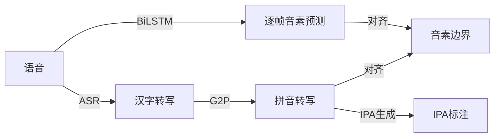

# GPIPA: 简单快速的汉语边界检测和IPA转写工具

请参考：[技术文档](docs/technical.md) | [安装文档](docs/instllation.md)

## 原理图

## 模块
- `gpipa.acoustic` 提供了一个轻量级的边界检测和强制对齐工具。它使用 BiLSTM 模型进行逐帧音素分类，使用带记忆的 Viterbi 算法进行强制对齐。
- `gpipa.asr.qwen_asr` 是对 Qwen-ASR-0.6B 的一个简单包装。
- `gpipa.g2p` 是一个通用的 G2P 转换引擎，支持各种格式下拼音，IPA，汉字的相互转换
- `gpipa.pipeline` 负责 UI 背后的处理管线：ASR、hanzi2pinyin、TextGrid 生成，以及超过 5s 音频的 VAD 分段、分段处理与结果合并。
## 工作流程
### ASR 阶段（可选）
首先，对于不提供转写的语音，我们使用成熟的转写模型，将它转写为对应的汉字表达

这里，我们选用的参考模型是 Qwen3-ASR-0.6B，它功能强大，对处理能力需求相对也较低。

ASR 阶段处理后，我们通过 G2P 过程将汉字全部转为拼音格式，并进行一定程度的规范化，来匹配模型所实际使用的词表。

规范化时：具体地：
- 将 z, c, s + i 映射为 zii, cii, sii；zh, ch, sh + i 映射为 zhiii, chiii, shiii
- 遇到“儿”字后，倒着选字符去查 erhua.txt 文件，如果是儿化音，修正之

### 对齐阶段
这里，我们调用我们的 BiLSTM 模型，它的输出结果是每帧对应的音素概率分布。这个概率分布利用 `gpipa.acoustic.alignment` 模块中所实现的 Viterbi 算法进行对齐操作。

这个对齐操作的输入是模型预测的概率分布和标准音素转写，输出的是每个音素预测出的边界位置

### 转写阶段
得到边界位置后，再调用 G2P 模块中的 IPA 转换工具，生成 IPA 格式的数据

生成符合 Praat 标准的 TextGrid 文件，包含三个层级（Tiers）：
1. Sentence Tier：展示完整 ASR 转写汉字，时间覆盖整个 Chunk。
2. Word Tier：使用 jieba 对 ASR 文本分词，并根据音节数量按比例分配各词时间戳。
3. Phoneme/Syllable Tier：展示对齐后的 IPA 符号（核心数据）。

## 参考
我们使用了[华东师范大学的儿化词表](https://yywz.ecnu.edu.cn/1f/58/c30556a335704/page.htm)

## Gradio GUI

在 `gpipa.ui` 中，我们实现了一个 Gradio 界面，支持：

- 上传音频文件
- 在页面中编辑并保存 `config.yml`
- 运行完整 pipeline，并查看每个分段的 ASR / G2P / 对齐结果
- 下载生成的 TextGrid 文件

启动方式：

```bash
python3 -m gpipa.ui
```

默认地址：`http://127.0.0.1:7860`